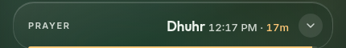

# Accordion

`custom:ui-accordion` · Layer: components · Status: Draft

Purpose: any glass card that has a one-line summary, shown in two modes: **collapsed** = a 60 px [Bar](bar.md); **open** = the full card. Reusable for any integration (owner, 2026-11-17).



```yaml
type: custom:ui-accordion
collapsed: true      # default: starts collapsed
remember: true       # default: keeps the viewer's last choice on this device
layout: stack        # optional: 52 px half-width dock bar instead of the 60 px bar
card:
  type: custom:ui-climate
  entities: [ { entity: climate.downstairs, name: Downstairs }, { entity: climate.upstairs, name: Upstairs } ]
```

## Which cards work

Every card with a summary: `ui-prayer` (next prayer and countdown, progress line), `ui-climate` ("Downstairs 72° · Upstairs 71°", short "72° · 71°"), `ui-media` (now playing), `ui-list` (items left), `ui-security` (all secure / what is open).

## Behaviour

- Collapsed: the whole bar is the button. The value has a long and a short form; the bar picks the one that fits its own width (always one line).
- Open: the card's chevron (top right or in its header slot) collapses it.
- Inside a [Section](../layout/section.md) the section's collapsed summary uses the same text.

## Accessibility

Bar `role=button`, `aria-expanded`, label "Climate: Downstairs 72° · Upstairs 71°, show".
