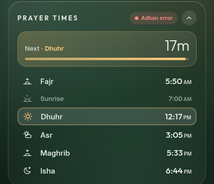

# Badge

Class `.badge` · Layer: components · Status: Draft

Purpose: a small status pill. The text always names the state; colour only repeats it.

| Modifier | Look | Example |
|---|---|---|
| `.badge-on` | mint text, glowing mint dot | Adhan on |
| `.badge-off` | dim text, grey dot | Adhan off |
| `.badge-error` | rose text on a rose tint, rose dot | Adhan error |



## Adhan badge (in `ui-prayer`)

Shown, never changed. Logic `adhanStatus()` (tested):

| Status | When |
|---|---|
| on | `adhan` (the playback switch) is on, every `adhan_automations` entry is on, and `adhan_error` is empty |
| off | the playback switch is off |
| error | the switch is unavailable or missing; or it is on but an Adhan automation is off or unavailable; or the last playback recorded a failure |

```yaml
type: custom:ui-prayer
adhan: input_boolean.adhan_enabled
adhan_error: input_text.adhan_last_error        # set by script.adhan_play on failure, cleared on success
adhan_automations: [automation.adhan_fajr, automation.adhan_dhuhr, automation.adhan_asr, automation.adhan_maghrib, automation.adhan_isha]
```

The error text is in the badge's tooltip (`title`).
