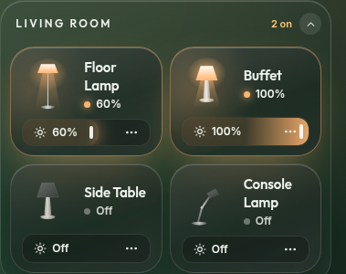
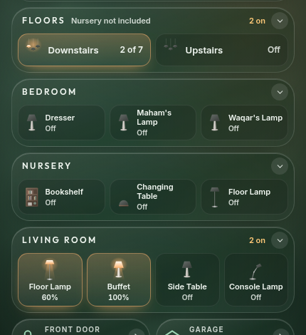

# Card

`custom:ui-card` · Layer: components · Lights and switches (a group of several entities works too)

Two forms: the **Large card** (its own element) and the **Compact card** (a chip that a collapsed Section draws for each light).

## Large card

Status: **Draft** (rebuilt 2026-11-17; becomes Locked after the owner's iPhone check)



Purpose: one light or group with art, name, state and a [Control pill](control-pill.md), with as little empty space as possible.

```yaml
type: custom:ui-card
name: Floor Lamp
art: floor-lamp            # see Content > Art
entities: [light.floor_lamp]   # one or more (lights and switch plugs may mix)
size: wide                 # optional: spans 12 columns
```

### Anatomy

| Part | Class | Size |
|---|---|---|
| Card | `.glass.lg` | min height 120 px (2 grid rows), padding 12 / 12 / 10 |
| Top row | `.top` | art column 56 px, gap 12, text column |
| Art | `.stage` | 56 px box |
| Title | `.title` | `title-sm` 15/20, up to 2 lines, never broken inside a word |
| State | `.state` | dot + "60%", "On", "Off", "2 of 7 on", "All off", "No response", "Not found" |
| Control pill | `.slider` or `.sw-pill` | 34 px tall, 44 px hit area |

Height went from about 248 px (art above, v11) to 120 px (art beside): about −52%.

### Behaviour

- Tap the card: on/off for all usable entities (lights and plugs each get their own domain call).
- Drag or tap the pill: brightness (dimmable lights). A vertical gesture scrolls the page, never dims.
- Three dots: the shade [Drawer](drawer.md).
- After 2.5 s without a state change: back to the real state and "No response" for 4 s.

### States

| State | Look |
|---|---|
| On | border and glow in the lamp colour, warm dot, value in text colour |
| Off | desaturated art, dim dot |
| Pending | "…" |
| No response / unavailable | 50% opacity, "No response" |
| Not found | "Not found"; partly missing group: "Missing: …" in rose |

### Accessibility

Card `role=button`, `aria-pressed`, label "Name: state". Slider `role=slider` with arrow keys (±10%).

## Compact card

Status: **Locked** (owner, 2026-11-17: habib-mkh-next)



Purpose: a small toggle for one light or group. Drawn by a [Section](../layout/section.md) with `collapsed_view: compact` (and by the older `habib-room`).

It picks its layout from its **own** width (container query):

| Own width | Layout |
|---|---|
| 150 px and wider | icon, name left, state right, one line |
| 100 to 149 px | icon left, name (up to 2 lines) over state |
| under 100 px | icon above, name and state centred |

At most 4 per row. Tap toggles; the name steps down to 10 px only if its longest word does not fit (never hyphenated).
