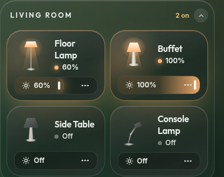

# Control pill

Layer: components · Status: Draft · Part of `ui-card`; on its own with `variant: control`

Purpose: one reusable control for anything with a nested flow: **on/off → brightness → shade**.



| Entity | Pill shows | Tap pill | Three dots |
|---|---|---|---|
| Dimmable light (or group) | sun icon, "60%" or "Off", fill in the lamp colour, knob | sets the level where tapped; drag = slide | shade [Drawer](drawer.md) |
| On/off light, switch, plug | power icon, "On" / "Off" | toggles (with the card) | none (nothing nested) |

## Standalone

```yaml
type: custom:ui-card
variant: control
name: Porch
entities: [light.smart_wi_fi_light_switch]
```

One grid row (56 px), 12 columns: name on the left, pill fills the rest.

## Anatomy

| Part | Class | Size |
|---|---|---|
| Track | `.slider .track` | 34 px tall, radius 12, deep well |
| Fill | `.fill` | lamp-colour ramp over the whole track, so the value text always sits on a dark part |
| Knob | `.knob` | 4 px |
| Value | `.pct` | `state` 12 px 600 |
| Dots | `.dots.tap` | 26 px visible, 44 px hit area |
| On/off pill | `.sw-pill` | 34 px |

## Rules

- Hit area at least 44 px (pseudo-element), visible size unchanged.
- Never in a lock, cover, alarm or climate card: those open their own dialog or drawer (see [Safety](../safety.md)).
