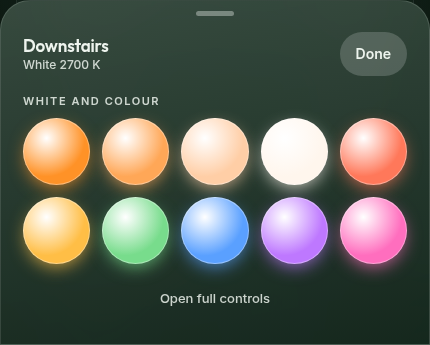
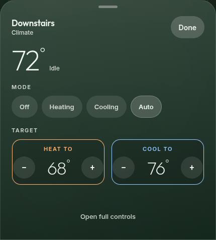

# Drawer

Layer: components · Status: Draft · Source: `openDrawer()` in base.js

Purpose: the pull-up panel for detail settings, in the same glass style (replaces HA's white dialogs where the library has its own controls). Bootstrap 6 calls the same pattern Drawer.

| Shade drawer | Climate drawer |
|---|---|
|  |  |

## Anatomy

| Part | Class |
|---|---|
| Scrim | `.scrim` (tap closes) |
| Panel | `.drawer` (max 560 px wide, radius 30 top, max 92% of the screen tall, scrolls) |
| Handle | `.drawer-handle` |
| Header | `.drawer-header`: title + sub, **Done** (`.drawer-done`, 44 px) |
| Group label | `.drawer-label.eyebrow` |
| Bottom link | `.drawer-link` "Open full controls" (HA's own dialog) |

## Shade drawer (from a Card's three dots)

Ten swatches, 5 per row: Candle 2200 K, Warm 2700 K, Neutral 4000 K, Daylight 6000 K, then Coral, Amber, Green, Blue, Violet, Pink (colours only when the light supports colour). A tap sends `light.turn_on` with `color_temp_kelvin` or `rgb_color`.

## Climate drawer (from a Climate dial)

Owner GREEN LIGHT climate controls, 2026-11-17. `ui-climate` only; the old `habib-climate` keeps HA's dialog until cutover.

1. Now: current temperature and what the system is doing (Idle, Heating now, …).
2. Mode: one button per `hvac_modes` (Off, Heating, Cooling, Auto). A tap sends `climate.set_hvac_mode` at once.
3. Target: Auto shows **Heat to** and **Cool to** steppers; Heating or Cooling shows one. − and + (44 px) change the shown value at once; 0.8 s after the last tap one `climate.set_temperature` call is sent.
4. Limits (logic `stepTarget`, tested): the thermostat's own min, max and step; Heat to stays at least 3° under Cool to.
5. Feedback: "Sending…" until Home Assistant reports the new value; "No response" after 4 s; "Not accepted" if the call fails.

## Rules

- Escape, Done or a tap on the scrim closes. Focus ring on every control.
- A drawer never controls a lock, cover or alarm.
