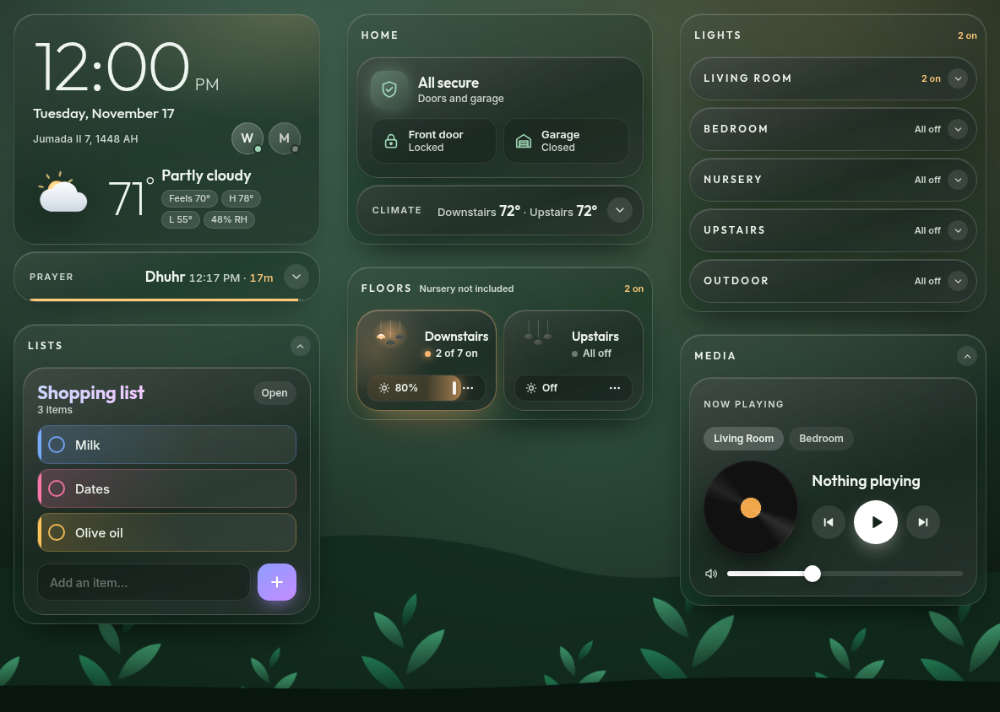

# Fluid rule

Layer: layout · Status: Draft · `ui-page` option `packing: fluid` · Logic `fluidPack()` (tested)

Purpose: on wide screens (Mac, iPad, wall tablet) the page arranges sections itself, so a dashboard needs no hand placement and the columns stay balanced. Phones are untouched: under 700 px the page shows one column in config order with each group's `compact_cards` (owner, 2026-11-17: the iOS views stay exactly as they are).



## The rule

| # | Rule | Config |
|---|---|---|
| 1 | **Chains:** a group stays directly under another group, in the same column. | `with: <group id>` |
| 2 | **Pins:** a group (and its chain) goes to a fixed column. `1` = leftmost, `-1` = rightmost, clamped to the column count. | `column: 1` / `column: -1` |
| 3 | **Balance:** every other group (with its chain) goes, tallest first, into the column that is currently shortest; ties go left. | – |
| 4 | **Reading order:** inside a column, groups are stacked in config order, so the top-left stays the top-left. | – |
| 5 | **No jumping:** columns are assigned once per column count (after a 1.5 s settle while cards render). Opening or closing a section later only moves what is below it in the same column; nothing moves sideways under the finger. A reload or a new column count re-balances. | – |
| 6 | **Inside sections:** cards flow on the section's 12-column grid (Large card 6, wide 12); they never need placement. | – |

Column count is the page rule: min(`max_columns`, floor((width + 32) / 352)).

## Example (habib-wh-next)

```yaml
type: custom:ui-page
packing: fluid
groups:
  - { id: hero,   column: 1,  cards: [ hero, accordion > prayer ] }
  - { id: home,   cards: [ section "Home" collapsible: false ], compact_cards: [ section "Home" ] }
  - { id: floors, with: home, cards: [ section "Floors" collapsible: false ], compact_cards: [ ... ] }
  - { id: lights, column: -1, cards: [ section "Lights" collapsible: false, holding one section per room with collapsed: true, remember: false ], compact_cards: [] }
  - { id: living, cards: [], compact_cards: [ section "Living Room" ] }   # phone only, one per room
  - { id: media,  cards: [ section "Media" ], compact_cards: [ section "Listen" ] }
  - { id: lists,  cards: [ section "Lists" ] }
```

## Measured (2026-11-17, mock states)

| Dashboard | Width | Columns | Result |
|---|---|---|---|
| habib-wh-next | 1184 | 3 | hero, prayer, Lists / Home, Floors / Lights, Media. Blank 0.32% |
| habib-wh-next | 1472 | 4 | hero, prayer / Home, Floors / Lists or Media / Lights. Blank 0.13% |
| habib-mkh-next | 1184 | 3 | hero, Media / Home, Floors / Lights. Blank 0.14% |
| both | 430, 375 | 1 | identical group order and positions to the previous phone view |

The exact column of Lists and Media depends on the real heights (prayer open or folded, rooms open), which is the point of the rule.
