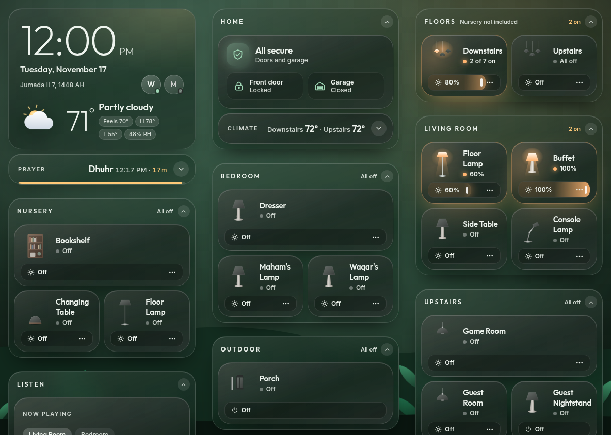

# Page

`custom:ui-page` · Layer: layout · Status: Draft

Purpose: the one container of a dashboard view. It packs groups into columns by its **own** width and paints the wallpaper from `habib-base`.



## Example

```yaml
views:
  - title: Home
    path: home
    type: panel            # one card fills the view
    theme: Habib Glass
    cards:
      - type: custom:ui-page
        max_columns: 4
        groups:
          - id: hero
            cards: [ { type: custom:ui-hero, ... }, { type: custom:ui-accordion, card: { type: custom:ui-prayer, ... } } ]
          - id: living
            cards: [ { type: custom:ui-section, title: Living Room, cards: [ ... ] } ]
```

## How it works

1. Columns = min(`max_columns`, floor((width + 32) / (`min_column` + 32))). No screen media query and no HA visibility condition, so no width renders blank.
2. Each group, in config order, goes into the column that is currently shortest (ties go left). Keyboard and screen-reader order stays config order.
3. Under `compact_below` (700 px) the page shows one column and each group's `compact_cards` when present.
4. A group that changes height (a section or accordion opened) is re-packed at once.

## Options

| Key | Default | Meaning |
|---|---|---|
| `groups[]` | required | `{ id, cards[], compact_cards[]?, label?, note? }` |
| `max_columns` | 4 | upper limit |
| `min_column` / `max_column` | 320 / 500 | column width limits (px) |
| `compact_below` | 700 | phone mode under this width |
| `wallpaper` | true | false = transparent page |

`compact_cards` absent = the group shows `cards` on a phone too; `compact_cards: []` = hidden on a phone; `cards: []` = hidden on wide screens. A group `label` adds a [Heading](../content/heading.md); groups that hold a Section need none.

## Measured (habib-wh-next, 2026-11-17)

Columns 1 / 2 / 3 / 4 at 430 / 820 / 1184 / 1472 px. Blank area between groups 0.33 to 0.51%. No sideways scroll at 375 to 1920.

## Do and don't

- Do put each room in its own group: the packer can only move whole groups.
- Don't nest a page in a page or in a section.
