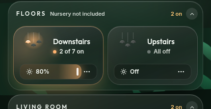
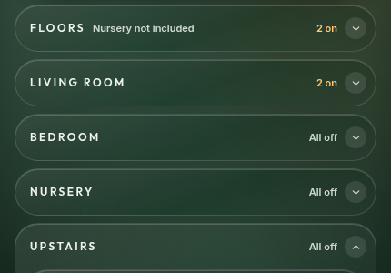

# Section

`custom:ui-section` · Layer: layout · Status: Draft

Purpose: an outlined, collapsible container that holds cards on a 12-column grid. The same pattern on phone and wide screens (owner, 2026-11-17).

| Open | Collapsed (`collapsed_view: none`) |
|---|---|
|  |  |

Collapsed with `collapsed_view: compact` shows a [Compact card](../components/card.md#compact-card) per light (the habib-mkh phone pattern).

## Example

```yaml
type: custom:ui-section
title: Living Room
note: Nursery not included     # optional, dim text after the heading
collapsed: false               # default: starts open
collapsed_view: none           # none | compact
cards:
  - { type: custom:ui-card, name: Floor Lamp, art: floor-lamp, entities: [light.floor_lamp] }
  - { type: custom:ui-card, name: Buffet, art: table-lamp, entities: [light.buffet] }
```

## Anatomy

| Part | Class | Notes |
|---|---|---|
| Container | `.glass` | glass surface, padding `--z-section-pad` (10) |
| Header | `.section-header` | whole row is the toggle; 44 px hit area |
| Heading | `.heading` | `section-sm` caps |
| Note | `.section-note` | optional, dim, one line, ellipsis |
| Summary | `.section-sum` | "2 on" (warm) or "All off"; for a section without lights, its children's own summaries joined with " · " |
| Chevron | `.fold` | up when open, down when collapsed |
| Body | `.section-body` | 12-column grid, gap `--z-gap-card` (8); each child spans its `getGridOptions().columns` |

## Behaviour

- Tap or Enter/Space on the header toggles. The choice is remembered per device (`remember: false` turns that off).
- Collapsed with `compact`: tapping a Compact card toggles its lights; the header opens the section.
- The page re-packs when a section opens or closes.

## Accessibility

Header is `role=button` with `aria-expanded` and a label that includes the summary ("Living Room, 2 on, collapse").

## Do and don't

- Do give every room its own section.
- Don't put a section inside a section. An [Accordion](../components/accordion.md) inside a section is fine (Home: Climate).
